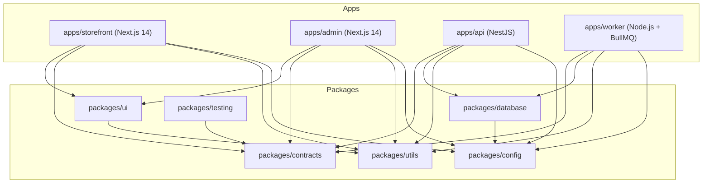

# LA MAIA — Workspace Dependency Graph

This document details the dependencies and boundaries between applications and shared packages in the `lamaia-commerce` workspace.

## Package Rules & Boundaries

1. **`packages/ui`**: Contains design tokens, styling presets, and UI components. Never imports `packages/database` or server-only secrets.
2. **`packages/contracts`**: Pure schemas (Zod) and TypeScript types. Zero side effects or native bindings. Safe to import anywhere.
3. **`packages/database`**: Prisma client and database models. Imported ONLY by server-side runtimes (`apps/api`, `apps/worker`). Forbidden in `apps/storefront` or `apps/admin` client code.
4. **`packages/utils`**: Deterministic financial math, date logic, and sanitization functions. Fully portable.
5. **`packages/config`**: Environment variable validation schemas using Zod.

